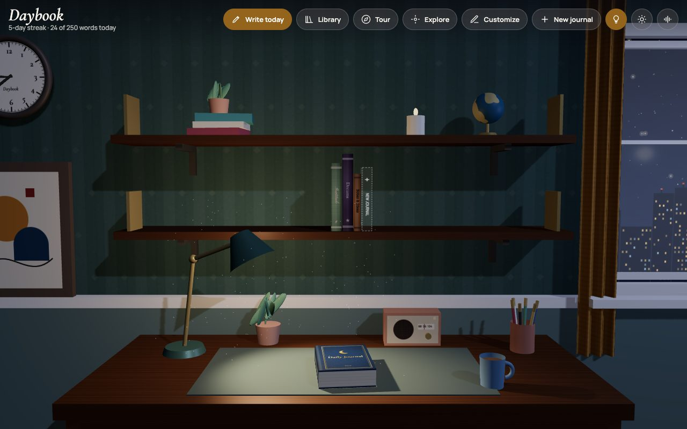
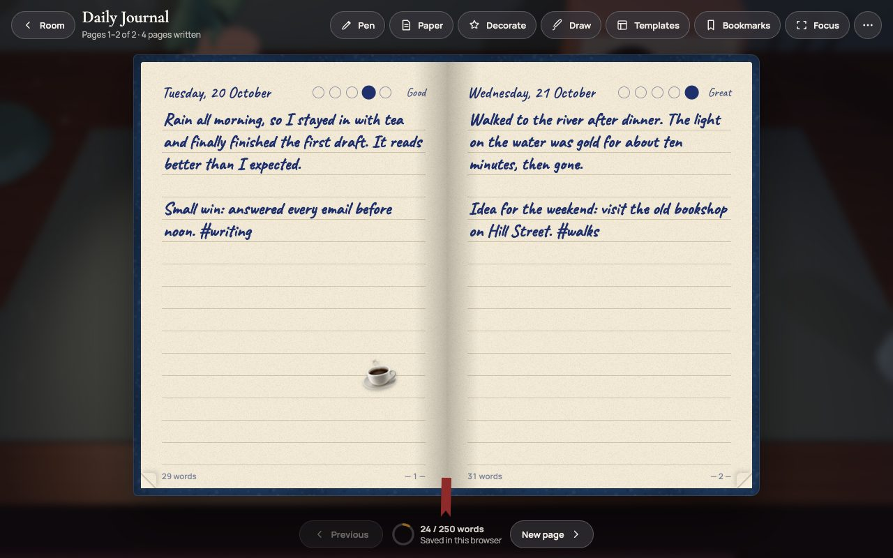
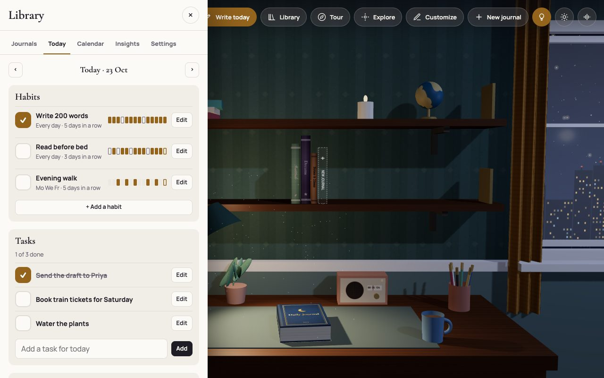
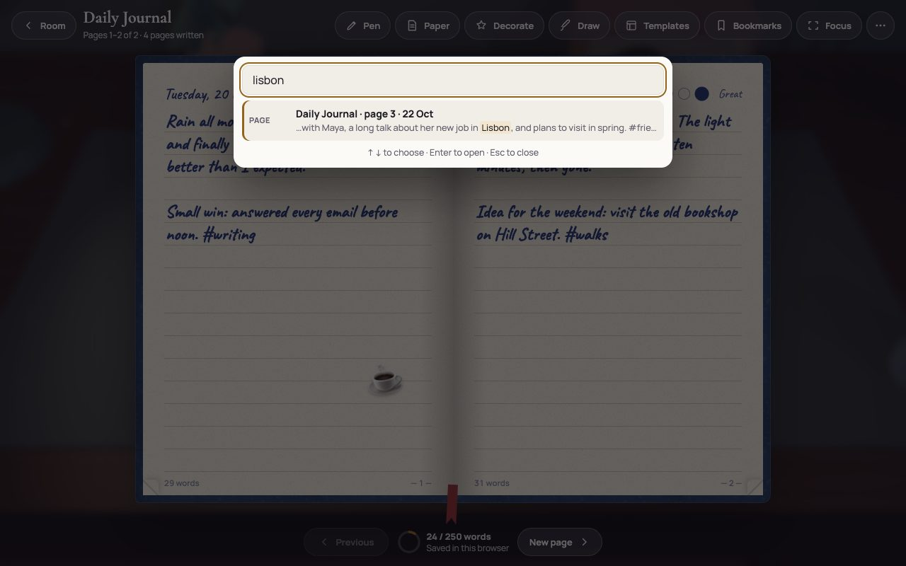
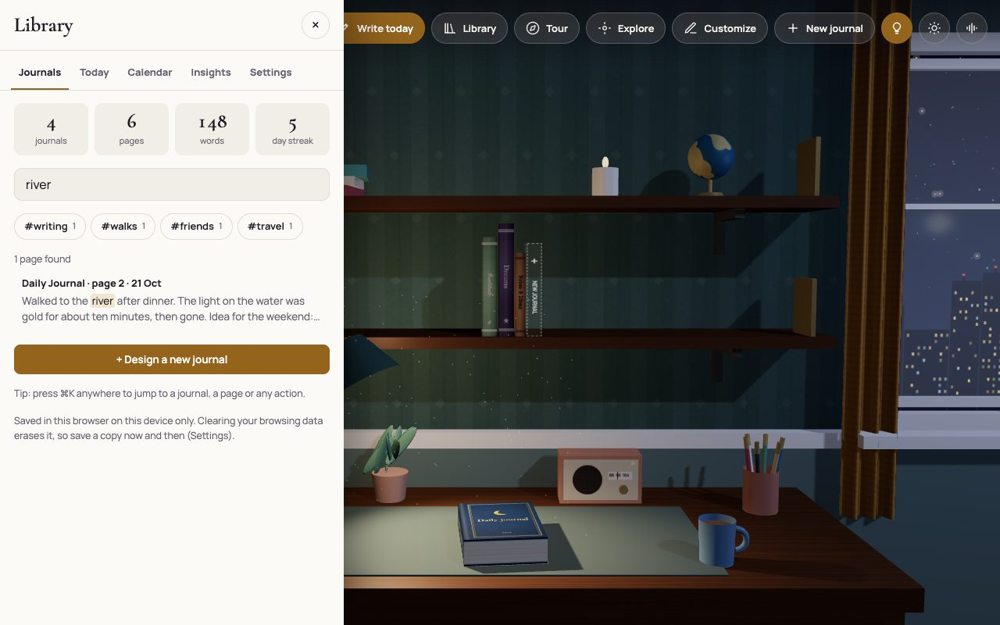
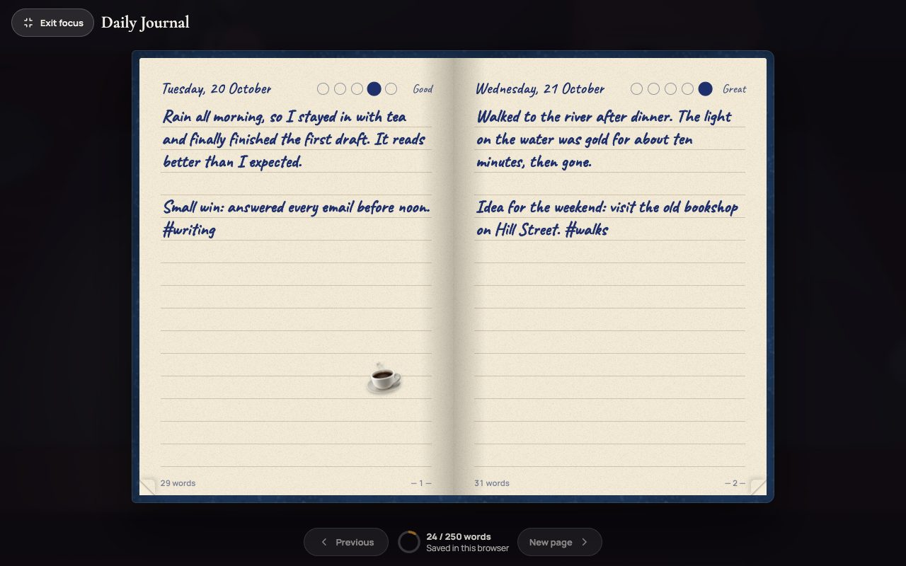

# Daybook

**A journal you write in inside a quiet 3D study.**

**Try it:** <https://awaneesh03.github.io/DayBook/>

Daybook is a journaling app in a single web page. You sit at a desk in a rendered study with a lamp, a window onto the
city and a shelf of journals. Take a journal down, open it, and write with a fountain pen, a pencil or a typewriter while
the ink appears as you type. Around the writing are small, practical tools: search across every journal, habits, tasks,
daily and weekly reviews, focus writing, and full backups.

It is plain HTML, CSS and JavaScript with [three.js](https://threejs.org/) for the room. There is no account, no server
and no tracking: your journals stay in your browser.



## Features

### The study
- A 3D room with a desk, lamp, wall clock, globe, radio, plants and a window with a day and night sky, rain and city lights.
- Take a journal from the shelf to the desk, open it, and the cover swings open into the pages.
- A guided tour, free exploration (W/A/S/D), a look out of the window, and arrange mode for the objects on the desk.
- A room customizer: walls, wood, lamps, wall art, weather, curtains, the clock, and saved presets.
- Ambient sounds (rain, fireplace, ocean, crickets, café) made in the browser, with no audio files.

### Writing
- Nine pens with their own handwriting and sound, twelve inks, ten papers and four rulings.
- Moods, #tags, templates and writing prompts, bookmarks, and up to 999 pages per journal.
- Photos, stickers, washi tape, notes, doodles and highlighting on the page.
- A cover studio for designing your own journals.
- Page turning with a curling page you can drag.

### Planning and focus
- **Today**, a tab in the library with **habits** (with streaks and a 14-day history), **tasks** for each day (unfinished
  ones can be moved to today when you ask), and **daily and weekly reviews**. A review is a journal page started from what
  you actually recorded that day or week, with questions to answer. It goes on a new page and never writes over anything.
- **Focus writing** hides everything but the page and a quiet word count.

### Finding things
- **Search** every journal from the library. Every word must match; accents and case are ignored (`cafe` finds `Café`),
  and dates count too (`trip february`).
- **Quick navigation**: press <kbd>⌘K</kbd> (or <kbd>Ctrl+K</kbd>) anywhere, even while writing, to jump to a journal,
  a page or any action.
- Calendar, insights (heatmap, moods, when you write), badges and "On this day" memories.

### Your data
- Journals are saved in this browser as you write. The reader shows **Saving…**, **Saved** or **Not saved yet**, and
  **Saved** only appears once everything really is stored.
- Writing that could not be saved (for example because browser storage is full) is kept and offered back after a reload,
  and nothing replaces a saved page unless you choose it.
- A **full backup** is one JSON file with every journal, page, photo, habit and task. Restoring checks the whole file first,
  shows what it holds, and saves a safety copy of what is there before replacing it.
- An optional PIN lock (a privacy screen, not encryption).

### Accessibility
- Every control has a name, dialogs move focus in and give it back, Escape closes what is on top, and writing, planning
  and navigation work from the keyboard. Reduced-motion settings are respected.
- These are automated checks plus manual testing, not a full WCAG audit.

## Screenshots

| | |
|---|---|
|  |  |
| **Reading and writing** | **Today: habits, tasks and reviews** |
|  |  |
| **Quick navigation (⌘K / Ctrl+K)** | **Search across every journal** |
|  | |
| **Focus writing** | |

The screenshots show made-up demo content.

## Live demo

<https://awaneesh03.github.io/DayBook/> is this repository's `main` branch, served by GitHub Pages. It is the same single
page: journals you write there are stored in your own browser for that address, and nothing is sent to a server.
Clearing the site's data erases them, so export a full backup now and then.

## Run it locally

You need **Python 3** to build and a recent browser with WebGL and an **internet connection**: three.js and the
handwriting fonts load from CDNs. Daybook is tested in Google Chrome (see [Known limitations](#known-limitations)).

```sh
git clone https://github.com/Awaneesh03/DayBook.git
cd DayBook
python3 build.py              # writes index.html from src/
python3 -m http.server 8000   # serve the folder
```

Open <http://localhost:8000> and press <kbd>Ctrl+C</kbd> in the terminal to stop the server. Opening `index.html`
directly from disk works too, but serve it if you can: some browsers (Chrome on Linux, for one) do not reliably keep
unsaved writing across a reload for pages opened from disk.

**If something looks wrong:** a missing 3D room and plain fonts usually mean the CDNs could not be reached. Daybook then
opens in a 2D mode where the library and journals still work. If port 8000 is busy, use another one
(`python3 -m http.server 8080`).

## Tests

The tests drive Google Chrome with [Playwright](https://playwright.dev/) and render the 3D room in software.

```sh
npm ci                              # installs playwright-core (tests only)
python3 build.py                    # always test a fresh build
npm test                            # every suite against a served copy, with a summary at the end
node tests/test_planner.mjs         # one suite
ONLY="search" node tests/test_planner.mjs   # tests whose name contains "search"
```

A single suite opens `index.html` from disk unless you give it the address of a served copy, for example
`node tests/test_saving.mjs http://localhost:8000/index.html`. On Linux, use a served copy: Chromium there does not always keep
`sessionStorage` across a reload for pages opened from disk. Set `CHROME=/path/to/chrome` if Chrome is not at the macOS
default location. The suites are:

| Suite | What it covers |
|---|---|
| `test_transitions` | Opening and closing journals (one cover at a time, Escape, rapid clicks, reduced motion), looking outside, pop-ups, emoji in animated ink |
| `test_weather_audio` | Weather, sky, ambience, volume, autoplay rules, persistence |
| `test_stability` | Rendered colours of the room, PIN lock, presets, text encoding, two tabs, full storage, export, the welcome dialog |
| `test_tour` | The guided tour and its controls on desktop and phone sizes |
| `test_backup` | Backup contents, restore, refusing bad or hostile files, storage full, other tabs, planner data, the Claude store (against a stand-in) |
| `test_saving` | The save status, Ctrl+S, failed saves, unsaved writing recovered after a reload, conflicts, the PIN |
| `test_planner` | Search, quick navigation, focus writing, habits and streaks, tasks, daily and weekly reviews |
| `test_a11y` | Control names, dialog focus, keyboard-only journaling, visible focus, tap target sizes, Escape |
| `test_journey` | One whole visit: write and style a page, reopen and reload, search, focus writing, a habit, a task and a review, a phone-sized window, then export, cancel and restore a backup |

CI runs the build check and every suite on each push (see `.github/workflows/ci.yml`).

## How it is built

```
src/p1_css_a.html, p2_css_b.html   page head and styles
src/p3_body.html                   markup
src/j1_core.js … j13_planner.js    scripts, in build order
        │
        ▼  python3 build.py  (concatenates; adds the three.js r128 script tag; byte-for-byte reproducible)
index.html                          the whole app, one static file
```

- All scripts share one closure: no modules, no framework, no bundler. Never edit `index.html` by hand.
- The 3D room is three.js r128. Covers, paper and textures are drawn on canvases.
- **Storage:** in a normal browser, journals are kept in `localStorage` (`daybook3d:v1` for journals, pages, habits, tasks
  and settings; `daybook3d:m:<id>` for photos). Inside Claude, where Daybook started as an Artifact, the same data goes
  to that account's private storage through `window.claude`.
- **Backups** are JSON: `{ format: "daybook-backup", version: 1, createdAt, lib, pages, media }`.
- `CONTEXT.md` explains the code, the data model and the details that are easy to break.

## Storage, privacy and backups

- **Where it lives:** in this browser, on this device. Another browser or device does not see it. Clearing site data
  erases it, so export a full backup now and then (Library, Settings, "Export full backup").
- **What a backup holds:** every journal and cover, every page (text, mood, stickers, tape, notes, photos, drawings),
  habits, tasks, review pages, presets and settings. It does **not** hold your PIN, or writing that has not been saved yet.
- **Restoring** replaces everything on this device; it is not a merge. Before it writes anything it saves a safety copy
  named `daybook-before-restore-<date>-<time>.json` to your downloads. Daybook can hand that file to the browser but
  cannot check that it was kept.
- **Not encrypted:** the PIN only hides the journals on screen. Anyone with access to the browser profile can read them.
- **Other tabs:** two tabs of Daybook keep each other's journals and pages. A restore in one tab stops the others from
  saving older data, but a narrow race remains: it is reported after the reload rather than prevented. Habits, tasks and
  settings are saved as one record, so two tabs changing them at the same moment keep the last change.
- **Offline:** the page needs the internet to load three.js and the fonts. Without it, Daybook opens in 2D mode with
  plain fonts, and journals still open, save and search.

## Known limitations

- The test suites run in Google Chrome (headless, software rendering). WebKit (Safari's engine) has had a smoke run of
  the main and new features at desktop and phone sizes, not the full suites. Firefox and real phones have not been tested.
- The Claude storage path is tested against an in-page stand-in, not the real service. Writes from another device at the
  moment of a restore are not guarded.
- Unsaved writing is kept for a reload in `sessionStorage`, so it survives reloading that tab, not closing it. Chrome on
  Linux does not reliably keep it for a page opened from disk; served pages (a local server or a website) keep it.
- Daily and weekly reviews count as written pages, like pages started from a template, so they add to word counts and streaks.
- On portrait phones the room shows only its middle, and at 460 px or narrower some header buttons move into the Library.
- While the cover swings open or closed, its edge briefly overlaps the reader's top bar.
- One stability run once lost a custom preset saved just before a reload. It has not happened again, so the cause is
  unknown and it is not fixed.
- Drifting Clouds only dims the sky; Starry Twilight looks like a clear night. Changes synced from another tab apply to
  the room and sound after a reload.
- Entries made before the text-encoding fix may show garbled symbols in template boxes or stickers. Typed text was never
  affected, and nothing repairs these automatically.

## Roadmap

These are ideas, not promises, and none of them exist yet:

- Testing in Firefox and on real phones and tablets.
- Optional encryption of stored journals.
- Exporting a single page or a date range as Markdown.

## Contributing

Bug reports and pull requests are welcome. See [CONTRIBUTING.md](CONTRIBUTING.md) for setup, the build and the tests,
and [SECURITY.md](SECURITY.md) for reporting a vulnerability privately.

## License

This repository does not have a license yet. Until one is added, the default copyright rules apply, which means the code
may not be reused without the author's permission.

## Credits

- [three.js](https://threejs.org/) r128 (MIT License), loaded from cdnjs.
- Fonts from [Google Fonts](https://fonts.google.com/), under the SIL Open Font License or the Apache License 2.0:
  Cormorant Garamond, Manrope, Caveat, Kalam, Patrick Hand, Reenie Beanie, Nanum Brush Script, Dancing Script,
  Pinyon Script, Homemade Apple and Special Elite.
- [Playwright](https://playwright.dev/) (Apache License 2.0), used only by the tests.
